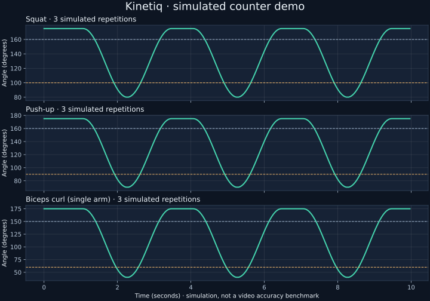
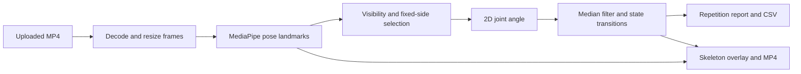

# Kinetiq
### Video-based repetition tracking with explainable motion analysis

Choose an exercise, upload a side-view video, and get a skeleton overlay, an angle timeline and a downloadable repetition report.

**Python · MediaPipe · OpenCV · Streamlit**

[Automated checks](../../actions/workflows/tests.yml) · [Validation and limitations](docs/validation.md) · [Deployment](docs/deployment.md)

## Try it

Run the app using the steps below, then click **Try a simulated example**. This demonstrates the actual counter and reporting code without a video or model download. The example is explicitly labelled as simulated; it is not evidence of pose-estimation accuracy.



For real analysis, upload a short MP4 containing one person. Select the exercise and, when needed, the working side. The pose model runs on the machine hosting the app.

## Features

- Squats, push-ups and single-arm biceps curls.
- Pose landmarks and repetition count overlaid on an exported H.264 MP4.
- Time-based angle filtering and endpoint confirmation to reject brief spikes.
- Fixed-side tracking, visibility checks and interruption handling.
- Per-repetition timestamps, duration and minimum filtered angle.
- CSV export with exercise, tracked side and data source.
- Processing progress, joint-measurement coverage and clear input errors.
- Automatic model download with SHA-256 verification.
- Tests for geometry, counting, video export, reports, model setup and the Streamlit UI.

This is a computer-vision portfolio prototype. It uses a pretrained model for pose estimation and custom rules for counting. It does not automatically recognize exercises, assess technique or provide medical guidance.

## Quick start — Windows

Use 64-bit Python **3.13**. In the cloned repository:

```powershell
py -3.13 -m venv .venv
.\.venv\Scripts\python.exe -m pip install -r requirements.txt
.\.venv\Scripts\python.exe -m streamlit run app.py
```

The first real analysis downloads approximately 6 MB from Google's model storage. Later analyses use the verified local file. To download in advance:

```powershell
.\.venv\Scripts\python.exe model_setup.py
```

If upgrading an older Kinetiq environment that installed both OpenCV variants, remove both and reinstall the required one:

```powershell
.\.venv\Scripts\python.exe -m pip uninstall -y opencv-python opencv-contrib-python
.\.venv\Scripts\python.exe -m pip install -r requirements.txt
```

Do not install multiple OpenCV packages in the same environment: they share the `cv2` module. MediaPipe requires `opencv-contrib-python`, which is the variant pinned here.

## Linux

Install the packages listed in `packages.txt`, then use Python 3.13:

```bash
python3.13 -m venv .venv
.venv/bin/python -m pip install -r requirements.txt
.venv/bin/python -m streamlit run app.py
```

A Windows clean installation has been verified locally. The included GitHub Actions workflow checks Windows and Linux after you push; a hosted run is not claimed until it actually passes.

## Exercises

| Exercise | Measured angle | Extended / bent thresholds | Starting position |
| --- | --- | --- | --- |
| Squat | Hip–knee–ankle | Above 160° / below 100° | Standing |
| Push-up | Shoulder–elbow–wrist | Above 160° / below 90° | Top position, arms extended |
| Biceps curl | Shoulder–elbow–wrist | Above 150° / below 60° | Working arm extended |

These are initial counting thresholds, not validated technique standards. Each complete cycle must return to the extended position. For curls, choose the working arm explicitly. Left/right refers to your body, not the screen. Alternating-arm and combined two-arm totals are not supported.

## How it works



MediaPipe estimates 33 body landmarks and uses tracking in video mode. OpenCV draws the relevant points; the drawing itself does not perform tracking.

The angle calculation converts normalized coordinates to pixels before applying the dot product, so rectangular image dimensions are respected. The app uses a trailing median over approximately 0.15 seconds and requires each endpoint to persist for approximately 0.15 seconds.

The counter follows **waiting → extended → bent → extended**. Only the final confirmed return counts a repetition. Missing or out-of-frame joints reset the unfinished cycle and filter, while preserving completed repetitions.

## What is custom and what is pretrained?

**Pretrained:** MediaPipe Pose Landmarker Lite detects body landmarks. No model training is performed in this repository.

**Custom application logic:** exercise definitions, joint geometry, visibility checks, side selection, temporal filtering, repetition state transitions, reports, video annotation, UI and tests.

| File | Purpose |
| --- | --- |
| `app.py` | Upload, demo, progress and results UI |
| `exercises.py` | Exercise landmarks, thresholds and recording instructions |
| `pose_analysis.py` | Decode frames, run inference, calculate angles and export video |
| `repetition_counter.py` | Filter angles, track cycles and produce reports |
| `reporting.py` | CSV export |
| `model_setup.py` | Download and verify the versioned model |
| `demo.py` | Explicitly simulated angle example |
| `tests/` | Unit, integration and UI tests |

## Tests and validation

```powershell
.\.venv\Scripts\python.exe model_setup.py
.\.venv\Scripts\python.exe -m unittest discover -s tests -v
.\.venv\Scripts\python.exe -m pip check
```

The suite covers three exercises, both sides, interrupted/partial repetitions, spikes, 15/30/60 FPS sequences, report values, CSV provenance, model integrity, corrupt input, duration limits, video export and UI state changes.

**No real-video count-accuracy benchmark has been established.** Synthetic checks verify implementation behavior; the real-model smoke test uses a blank video and only verifies that inference and export run successfully. See [the validation record](docs/validation.md).

## Limits and privacy

- One person, fixed camera and side view with tracked joints visible.
- At most 100 MB and 2 minutes per upload.
- The app assumes the selected exercise. Elbow motion alone cannot distinguish a push-up from a curl.
- Occlusion, camera angle, clothing and brief endpoints can cause missed or incorrect counts.
- Angles are 2D projections. Times include filtering/confirmation delay.
- Measured-frame coverage is not an accuracy or technique score.
- Export has no audio; longest side is at most 960 pixels. Constant reported FPS is used, so variable-frame-rate phone videos can have timing differences.
- Videos are processed by the host running the app, not sent to an external AI API. Temporary processing files are deleted on success or failure. Uploaded bytes and results remain in the session; selecting a new video, exercise or side clears results.
- Model files, local secrets and uploaded recordings are excluded from Git.

## Model attribution

[MediaPipe Pose Landmarker](https://developers.google.com/edge/mediapipe/solutions/vision/pose_landmarker?tab=Python), provided by Google. This project uses the Lite float16 model, version 1, downloaded separately from official storage. The exact source URL and SHA-256 are in `model_setup.py`. Model and dependency terms remain those of their respective providers.

## CV description

> Built a Python computer-vision application using MediaPipe, OpenCV and Streamlit to track three exercises, count repetitions with temporal filtering, and export annotated videos and per-repetition CSV reports. Added automated geometry, integration and UI tests.

Use this as a description of the implemented project. Do not claim custom model training or measured real-world accuracy without doing and documenting that work.
